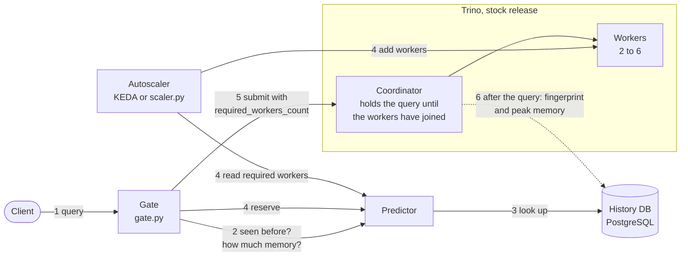

# Memory-history PoC

This PoC predicts the peak memory of a repeated query from its earlier runs. It uses the prediction to add
Trino workers **before** the query runs. It does not change Trino core.

- Design and contracts: [PLAN.md](PLAN.md)
- Results of the full run: [results/REPORT.md](results/REPORT.md)
- Cluster calibration: [workload/CALIBRATION.md](workload/CALIBRATION.md)
- Kubernetes details: [k8s/README-k8s.md](k8s/README-k8s.md)

## How it works



Steps 1–5 act on a query before it runs. Step 6 (dashed) is how the system learns. The event listener
plugin inside the coordinator records every completed query. A query with an unknown shape skips steps 4–5
and runs unchanged.

| Part | Where | What it does |
|---|---|---|
| Fingerprint | `lib/trino-memory-history-fingerprint` (`QueryFingerprint`) | SQL → hash. Literals become `?`, case/whitespace/comments ignored, tables included. |
| Event listener | `plugin/trino-memory-history` | On every completed query: writes fingerprint, peak memory, state and error code to PostgreSQL. |
| Predictor | `service/trino-memory-history-predictor` | `POST /v1/predict` → predicted peak and required workers. Holds reservations. `GET /v1/required-workers` for the scaler. |
| Gate | `gate/gate.py` | Client-side. Asks the predictor, reserves, submits the query with `required_workers_count` so Trino itself waits. |
| Scaler | KEDA `metrics-api` trigger (k8s) or `gate/scaler.py` (compose) | Sets the number of workers to what the predictor reports. |

Prediction rule:

- The prediction is the largest peak among the last 10 successful runs of the fingerprint.
- If the query failed with a memory error *after* its last successful run (or never succeeded), the
  prediction is the largest known peak × 2.
- The predictor ignores a memory failure that is older than a later success.
- Required workers = `ceil(predicted × 1.5 / query.max-memory-per-node)`, between 2 and 6.
- An unknown fingerprint gets no prediction and runs unchanged.

## Prerequisites

You need Docker, Python 3, JDK 25 and `mvnd` (or `./mvnw`). For the Kubernetes demo, you also need `kind`,
`kubectl` and `helm`. The images need about 8 GB of free disk. The stack uses up to 7 containers with
4 GB heap each.

All commands below start from `poc/memory-history/`.

## 1. Build the images

```bash
docker/build-images.sh
# -> trino-memory-history:poc             (trinodb/trino:484 + the plugin)
# -> trino-memory-history-predictor:poc
```

The script builds the three PoC modules and the Trino modules they depend on (`-am`). Thus the first
run on a fresh checkout takes several minutes. I tested the Maven step with an empty Maven cache: it built 11 modules. I did not run the full script on a second machine.

The unit tests are optional and need Docker for Testcontainers. The test command needs the Trino modules
that the PoC depends on in the local Maven cache. `build-images.sh` does not put them there. Install them once. This writes Trino SNAPSHOT artifacts into your local Maven cache, so do not do it in a cache that other Trino checkouts share:

```bash
M=lib/trino-memory-history-fingerprint,plugin/trino-memory-history,service/trino-memory-history-predictor
(cd ../.. && mvnd -pl $M -am install -DskipTests -Dair.check.skip-all=true)   # once
(cd ../.. && mvnd -pl $M test -Dair.check.skip-all=true)                      # 39 tests
```

## 2. Python environment

```bash
python3 -m venv .venv && .venv/bin/pip install -r gate/requirements.txt
```

If `python3 -m venv` fails because `ensurepip` is missing, do these steps:

1. Create the environment with `python3 -m venv --without-pip .venv`.
2. Install pip with `get-pip.py`.

## 3. Run on docker compose

```bash
cd compose
DC="docker compose -f docker-compose.yml -f docker-compose.full.yml --profile full"
$DC up -d --scale worker=2          # coordinator :18080, predictor :18090, postgres :15432
cd ..
```

Cluster: 4 GB heap per node, `query.max-memory-per-node=1GB`, `query.max-memory=6GB`. The
coordinator runs no queries. The ports and limits are in `compose/.env`.

### 3a. One query by hand

```bash
Q="SELECT count(*) FROM orders WHERE orderkey > 100"
.venv/bin/python gate/gate.py --catalog tpch --schema tiny -e "$Q"      # first run: unknown, runs unchanged
.venv/bin/python gate/gate.py --catalog tpch --schema tiny -e "${Q/100/7}"   # other literal: known
curl -s -X POST localhost:18090/v1/predict -H 'Content-Type: application/json' \
     -d "{\"sql\": \"$Q\", \"catalog\": \"tpch\", \"schema\": \"tiny\"}"
docker exec mhpoc-postgres-1 psql -U memoryhistory -d memoryhistory -c \
  "select left(fingerprint,12) fp, query_state, error_code, peak_user_memory_bytes, tables from query_history order by end_time desc limit 5"
```

### 3b. The full loop: learn, then predict

```bash
# Pass 1: no gate, 2 workers. Heavy queries fail with EXCEEDED_LOCAL_MEMORY_LIMIT. Everything is recorded.
.venv/bin/python workload/run_workload.py --pass learn --no-gate

# Start the scaler (stands in for KEDA) in a second terminal:
.venv/bin/python gate/scaler.py --compose-arg=-f --compose-arg=docker-compose.yml \
    --compose-arg=-f --compose-arg=docker-compose.full.yml --compose-arg=--profile --compose-arg=full

# Pass 2 and 3: through the gate. Heavy queries get more workers first and finish.
.venv/bin/python workload/run_workload.py --pass predict
.venv/bin/python workload/run_workload.py --pass predict

.venv/bin/python workload/report.py       # writes results/REPORT.md
```

One pass takes about 9 minutes (13 query templates × 3 literal variants, see `workload/workload.yaml`).
To run a part of the workload, use `--only tpch_q21` or `--size heavy`.

To stop the stack, run `cd compose && $DC down`. To also delete the history, add `-v`.

## 4. Run on Kubernetes (kind + Helm + KEDA)

```bash
cd k8s
TRINO_IMAGE_REPO=trino-memory-history TRINO_IMAGE_TAG=poc \
PREDICTOR_IMAGE=trino-memory-history-predictor:poc LISTENER=1 ./up.sh
./demo.sh status
./demo-gate.sh          # heavy query: fails without the gate, then scales up and finishes with it
./down.sh               # deletes only the kind cluster "mhpoc"
```

`up.sh` creates a kind cluster with the name `mhpoc` and its own kubeconfig (`k8s/.kubeconfig`). It
does not change the default kubeconfig or other clusters. Every 5 s, KEDA reads `GET /v1/required-workers`
from the predictor. It sets the replicas of the worker Deployment to that number (2 to 6).

## What the full run showed

Setup: the compose stack, the real plugin and predictor, 117 workload runs, and an empty history at the
start. These are the numbers of the second full run, which I made after the review fixes. The first run
gave the same picture. Details: [results/REPORT.md](results/REPORT.md).

| Question | Result |
|---|---|
| Do literal variants share one fingerprint? | Yes: 13 templates → 13 fingerprints, 3 variants each. |
| Hit rate in the gated passes | 78 of 78 (every query shape repeats in this workload). |
| Prediction accuracy, peak ≥ 100 MB, predicted from successful runs | predicted / actual: median 1.06, p90 1.09, range 0.96–1.25 (28 runs). **In-sample:** the same literals ran before. |
| The same, predicting each run only from the *other* literal variants of its shape (retrospective cross-check) | median 1.05, p90 1.08, range 0.98–1.25 (45 runs). |
| Prediction accuracy, predicted from a memory failure | median 2.39, range 0.98–2.51 (8 runs). It usually over-provisions. Once it was slightly low (0.98), and the safety factor covered it. |
| Heavy queries failing ungated on 2 workers | 9 of 9 variants (TPC-H q09, q18, q21 at sf5). |
| The same queries through the gate | 18 of 18 gated heavy runs finished. Only 2 of them caused a scale-up themselves (3→6 workers, about 20 s wait in Trino). The other 16 found enough workers from the query before. Those workers were still running because scale-down waits 120 s. |
| Memory spread across literal variants of one shape (≥ 100 MB) | max/min 1.04–1.25. |
| Prediction rule changed after this run | In this run, the predictor gave TPC-H q18 3.8 GB (6 workers) in all 6 gated runs. The query used 1.6 GB. The cause: an old memory failure reached a higher peak than the later successes. The rule now ignores a failure after a later successful run. I checked this with a run of only the heavy queries (`results/heavy-check.jsonl`): q18 asks for 6 workers once, then 3. In that check the cluster stayed at 6 workers, so I did not see q18 run on 3. |
| Failures in the gated passes | 1 of 78: a small query (TPC-DS q55) failed with `PAGE_TRANSPORT_TIMEOUT` when the compose scaler removed workers under it. The same query failed the same way in the first run. |

### On Kubernetes (kind, real images)

`./demo-gate.sh` with TPC-H q21 at sf5. Run log: `results/k8s-runs.jsonl`, worker timeline: `results/k8s-workers.log`.

| Step | Result |
|---|---|
| 3 variants without the gate, 2 workers | all 3 failed with `EXCEEDED_LOCAL_MEMORY_LIMIT` (peak reached 1.6–1.8 GB) |
| Variant 0 through the gate | Predicted 3.7 GB from the failures → 6 workers requested. KEDA had 6 pods running in about 14 s. Trino saw 6 active workers about 35 s after the request. The query waited 30 s and finished (peak 3.4 GB, 51 s in total). |
| Variants 1 and 2 through the gate | Predicted 3.6 GB from the successful run, actual 3.5 GB. No wait, finished in 12–13 s. |
| After the last query | reservation released, required workers back to 2 |

## If PostgreSQL or the predictor is down

- The listener never fails a query:
  - Inserts run on a background thread with 10 s timeouts.
  - At most 1,000 records wait in memory. The listener drops and counts extra records.
  - If the history table disappears, the listener creates it again.
- The predictor answers `503` within about 3 s when it cannot connect to PostgreSQL. At most 16 predictions run at once.
- The gate treats any predictor error as "unknown query". It prints a warning and submits the query unchanged. With `--require-predictor`, it exits with code 2 instead and submits nothing. `report.py` shows how many gated runs had no predictor.

## Known limits

- **Only repeated queries.** A new query shape runs unchanged and can fail. Its failure teaches the next run.
- **Text fingerprint.** Literals that change the data volume (a 1-day vs a 1-year range) share one fingerprint. The literals of the workload did not change memory much. Real workloads may.
- **No per-node peak.** Trino reports a cluster-wide peak and the largest single task, not a per-node peak. The predictor calculates workers as total / per-node limit with a 1.5 safety factor. Skewed data or broadcast joins need more (TPC-H q18 needs 3 workers at 1.7 GB).
- **Scale-down can kill queries on compose.** `scaler.py` removes worker containers abruptly. One small query failed with `PAGE_TRANSPORT_TIMEOUT` in both full runs, at the same point (scale-down from 6 to 2 workers). The Kubernetes setup uses the graceful worker shutdown of Trino.
- **Small queries are noisy.** Peaks under about 10 MB vary from bytes to megabytes between runs. They do not affect scaling.
- **Long queries can outlive their reservation.** The reservation lasts 1 hour, and nothing refreshes it.
- **The gate is client-side.** Clients that do not use it get no prediction. Reservations live in the memory of the predictor, and a restart loses them.
- **The listener also records monitoring queries** (for example the `system.runtime.nodes` query of the gate).
- **The peak of a failed run is only a lower bound.** q21 reached 1.7 GB when it failed on 2 workers. It used 3.3 GB when it finished. The × 2 growth factor happened to cover that.
- **Cluster size is not part of the history.** The history mixes runs on 2, 4 and 6 workers. I did not analyse whether the peak of a query depends on the worker count.

## Layout

```
lib/trino-memory-history-fingerprint/      SQL fingerprint, shared by the plugin and the predictor (Java)
plugin/trino-memory-history/               event listener, PostgreSQL store (Java)
service/trino-memory-history-predictor/    predictor HTTP service (Java)
poc/memory-history/
  docker/      image builds
  compose/     docker compose cluster
  gate/        gate.py, scaler.py (mock_predictor.py is test-only)
  workload/    queries, workload.yaml, run_workload.py, report.py, CALIBRATION.md
  k8s/         kind + Helm + KEDA
  results/     REPORT.md and the run logs
```
